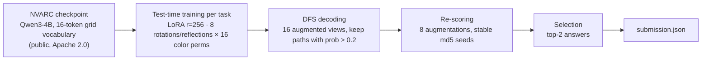

# ARC Prize 2026 — ARC-AGI-2

Solution for the Kaggle competition [ARC Prize 2026 — ARC-AGI-2](https://www.kaggle.com/competitions/arc-prize-2026-arc-agi-2).

**Final submission: `lb33-det` — 30.69 ± 0.42 % on the public leaderboard** (3 reruns: 31.11 / 30.69 / 30.28).

📄 **Paper (Solution Writeup): [`docs/writeup/WRITEUP.md`](docs/writeup/WRITEUP.md)** — the best place to start.

## The task

Each ARC task shows a few input/output grid pairs that follow an unknown rule. The system must
predict the output for new test inputs, with 2 attempts per test input; a task counts if either attempt
is exactly right. Scoring runs offline on 240 hidden tasks, with a 12-hour limit on 4 × L4 GPUs.

## The approach



The final pipeline is the public LB33/NVARC notebook plus three changes:

1. **Cheapest tasks first** in the work queue.
2. **Stable random seeds** for re-scoring (md5 instead of Python's salted `hash()`).
3. **No per-task time cap**, only the global deadline.

Changes 2 and 3 removed two sources of run-to-run noise: **+1.66 points and 3× less variation**.

## Main findings

- **Test-time training is the engine.** It is worth +21 of the 31 points, and its recipe is a narrow
  optimum: all five variants tried on the leaderboard lost.
- **Time is a cliff.** The pipeline uses 95 % of the 12 hours, so any change that costs more than ~5 %
  extra time per task loses tasks at the end of the queue.
- **The remaining gap is generalization to new rules.** The model learns the rule as the demos show it,
  but ARC-AGI-2 test inputs fall outside what the demos show. More data, bigger models, ensembles and
  program search did not help.
- **A newer base model** (Qwen3.5-4B) starts 5 % better but loses the advantage after the same training.

Every experiment, with its pre-registered prediction and result, is logged in [`PLAN.md`](PLAN.md)
and `docs/PREREG_*.md`.

## Repository layout

```
scripts/            Notebook builders (build_*.py), Kaggle push tool (push_kernels.py), analyses
  └─ make_writeup_figs.py   Regenerates every figure of the paper
notebooks/          Generated Kaggle notebooks; final submission = notebooks/lb33_det.ipynb
src/arc/            Python package: selection scorers, held-out split, synthetic data generator
vendor/barc/        Vendored BARC primitives and seeds (program-synthesis experiments)
docs/
  ├─ writeup/       ★ The paper and its figures (English)
  ├─ TACTICS.md     Long technical explanation of every tactic (English)
  ├─ working_note_en.md   Narrative working note (English)
  └─ other docs     Research log: plans, pre-registrations, audits (mostly Spanish)
data/               Competition data (not versioned; see below)
```

## Setup

```bash
python -m venv .venv && .venv\Scripts\activate   # Windows
pip install -r requirements.txt
# Kaggle credentials in .env (KAGGLE_API_TOKEN, kaggle_username)
python scripts/download_data.py
```

Notebooks run headless on Kaggle GPUs: `python scripts/push_kernels.py <name> --accelerator NvidiaL4`.

## Note on validation

The NVARC checkpoint was trained on the public evaluation set, so improvements must never be measured
on `arc-agi_evaluation_challenges.json` with that model. All verdicts in this project come from the
hidden leaderboard or from clean held-out sets.

## License

MIT (see [`LICENSE`](LICENSE)). Builds on NVARC (Sorokin and Puget, Apache 2.0), the public LB33
notebook, and the ARChitects' test-time training and DFS recipe.
