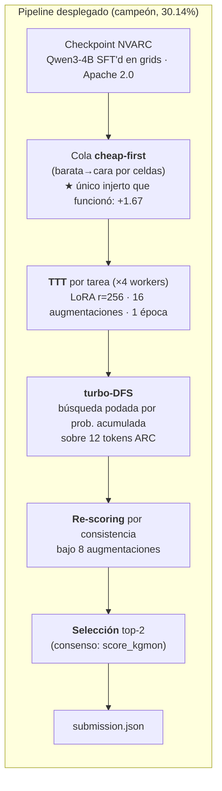
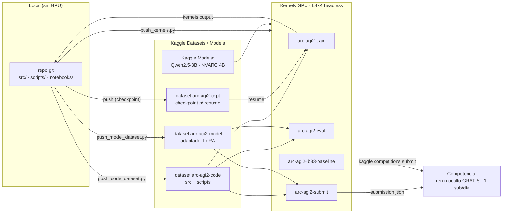

# ARC Prize 2026 — ARC-AGI-2

Solución para la competencia de Kaggle [ARC Prize 2026 — ARC-AGI-2](https://www.kaggle.com/competitions/arc-prize-2026-arc-agi-2).

> **Objetivo:** resolver tareas de razonamiento abstracto (grids de colores) prediciendo
> exactamente 2 outputs por cada input de test. Se acierta si **cualquiera** de los 2
> coincide exactamente con la verdad. El score final es el promedio sobre todos los test outputs.

## Reglas clave de la competencia (resumen)

| Aspecto | Detalle |
|---|---|
| Tipo | **Code competition** — se entrega un **Kaggle Notebook** que corre el modelo |
| Internet en evaluación | **NO** hay acceso a internet durante el scoring → todo debe ir empaquetado (modelo + pesos + código) |
| Runtime | Límite de tiempo de ejecución del notebook (≈12 h; el HW/compute se confirma en la página de reglas) |
| Métrica | `pass@2` por test output, promediado |
| Open source | El código y método deben publicarse con licencia permisiva para optar a premios |
| Premios | ~$700k total: Progreso (~$275k), Grand Prize por writeup (~$275k), Bonus $150k al alcanzar 85% |

> ⚠️ Las reglas exactas (HW, runtime, licencia aceptada) deben confirmarse logueado en
> la [página de reglas](https://www.kaggle.com/competitions/arc-prize-2026-arc-agi-2/rules).
> La distinta edición **ARC-AGI-3** sí permite APIs/internet; **ARC-AGI-2 NO**.

## Datos

Los datos de la competencia **NO** se versionan en este repo (ver `.gitignore`). Para descargarlos:

```bash
python scripts/download_data.py
```

Estructura (en `data/`):

- `arc-agi_training_challenges.json` — 1000 tareas de entrenamiento (con soluciones aparte).
- `arc-agi_training_solutions.json`
- `arc-agi_evaluation_challenges.json` — 120 tareas públicas de evaluación.
- `arc-agi_evaluation_solutions.json`
- `arc-agi_test_challenges.json` — copia pública del set de test (el privado real está oculto).
- `sample_submission.json` — formato de entrega: `{task_id: [{"attempt_1": grid, "attempt_2": grid}, ...]}`.

## Estrategia y estado actual

> 📘 **Explicación técnica extensa** — el problema, **cada táctica de entrenamiento e inferencia**
> (SFT, LoRA, TTT, aumentación, decodificación DFS, re-scoring, selección, síntesis verificable,
> data-gen compositiva) y dónde estamos: **[`docs/TACTICAS.md`](docs/TACTICAS.md)**
> (EN: [`docs/TACTICS.md`](docs/TACTICS.md)).
> Narrativa y resultados: [`docs/working_note_es.md`](docs/working_note_es.md) ·
> Números duros: [`docs/RESULTS.md`](docs/RESULTS.md) ·
> Auditoría del baseline: [`docs/LB33_AUDIT.md`](docs/LB33_AUDIT.md).

**Campeón actual: 30.14%** (LB semi-privado) = pipeline LB33/NVARC + nuestro injerto `cheap-first`.
Ese score coincide con el nivel del **ganador privado 2025** (NVARC, 24.03%), cuyo checkpoint
reutilizamos.



**Las tres conclusiones estructurales** (todas medidas en el LB, detalle en `TACTICAS.md` §16):

1. **El modelo fuerte quiere todo el cómputo.** Dos ensembles con partners más débiles (Qwen3-2B,
   TRM 7M) fallaron por la misma razón: el 4B es *coverage-limited*, así que ceder cómputo le quita
   cobertura y el partner no la repone. → No reintentar ensembles con partners débiles.
2. **El punto de operación del tiempo ya es óptimo.** Más tiempo/tarea → −2.08; menos → degradación
   severa. Ambas direcciones empeoran.
3. **Estamos en el techo del paradigma equivocado.** La transducción pura capa en ~40%; los
   ganadores son **híbridos** (inducción + transducción + TTT).

**Paso 3 (SFT de inducción con data sintética propia) — ejecutado y cerrado con negativo:**
generamos **13.271 tareas compositivas verificadas** sin LLM ni quota GPU, el SFT entrenó limpio
(loss 4.07→0.50), pero el A/B dio **0/16 vs 1/16** del modelo congelado. Causa raíz:
**verificable ≠ útil** — encadenar seeds aleatorias da tareas correctas pero no *ARC-like*, y el
modelo aprendió la forma en vez del razonamiento. Infraestructura reutilizable documentada.

> ⚠️ **Validación:** el checkpoint NVARC **incluyó el eval público en su SFT** → nunca medir
> mejoras contra `arc-agi_evaluation_challenges.json` con ese modelo. Held-out limpio: split
> reservado del training set + tareas sintéticas propias + leaderboard (1 submission/día gratis).

## Arquitectura y conectores en Kaggle

Sin GPU local: todo corre **headless** en kernels de Kaggle (sin sesiones interactivas, que
queman quota). El repo se conecta a Kaggle vía datasets/kernels; el rerun de la submission
sobre el set oculto es gratis.



Kernels definidos en `scripts/push_kernels.py` (`train`/`eval`/`submit`/`lb33`), todos
pusheados headless por CLI con la imagen Docker pineada y `machine_shape: NvidiaL4`.

> **Nota sobre el modelo:** modelos pequeños (3B–4B) son los viables aquí: MoEs grandes no
> caben offline ni permiten TTT por-tarea dentro de las ~12 h. El ganador 2025 usó ~4B.

## Estructura del repo

```
src/arc/            Paquete Python
  ├─ seedgen.py       Generador de data compositiva VERIFICADA (compone seeds ejecutables A→B)
  ├─ holdout.py       Split held-out determinista (hash estable entre procesos)
  ├─ select.py        Scorers de selección de attempts (kgmon, probmul y variantes)
  └─ infer/model/…    Pipeline propio: TTT, inferencia multi-candidato, runner multi-GPU
vendor/barc/        Recursos vendorizados de BARC
  ├─ common.py        Librería de primitivas ARC que usan los programas generados (1.551 líneas)
  └─ seeds/           163 seeds ejecutables (generate_input + main) para la data-gen compositiva
scripts/            Utilidades CLI (descarga de datos, push de kernels a Kaggle)
docs/               Documentación
  ├─ TACTICAS.md / TACTICS.md   ★ Explicación técnica extensa (problema + todas las tácticas)
  ├─ working_note_es/en.md      Working note (narrativa, estrategias exitosas y fallidas)
  ├─ RESULTS.md                 Registro de cada medición en el leaderboard
  ├─ SFT_PLAN.md                Plan y estado del Paso 3 (SFT de inducción)
  ├─ PROGRAM_SYNTHESIS.md       Receta de síntesis de programas verificable (BARC)
  ├─ LB33_AUDIT.md              Auditoría del baseline adoptado (limpio de hardcode/leakage)
  └─ STRATEGY.md                Estrategia histórica
notebooks/          Notebooks de Kaggle (submission, probes, SFT, data-gen)
data/               Datos de la competencia (NO versionado)
```

## Setup

```bash
python -m venv .venv && .venv\Scripts\activate   # Windows
pip install -r requirements.txt
# credenciales Kaggle en .env (KAGGLE_API_TOKEN, kaggle_username)
python scripts/download_data.py
```

## Licencia y open-source

MIT (ver [`LICENSE`](LICENSE)). Regla verificada (arcprize.org): **el código y método deben
open-sourcearse para optar a premios, en los 7 días tras el deadline** junto a un Solution
Writeup; durante la competencia lo privado es legal. Plan de publicación accionable (checklist,
licencias de dependencias verificadas): [`docs/OPEN_SOURCE_PLAN.md`](docs/OPEN_SOURCE_PLAN.md).
