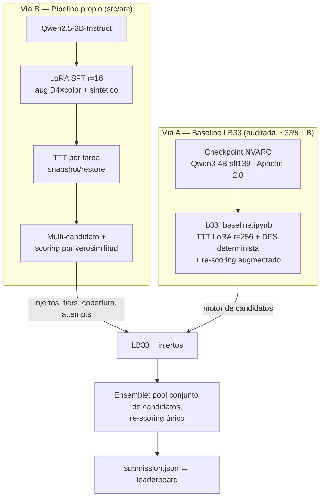
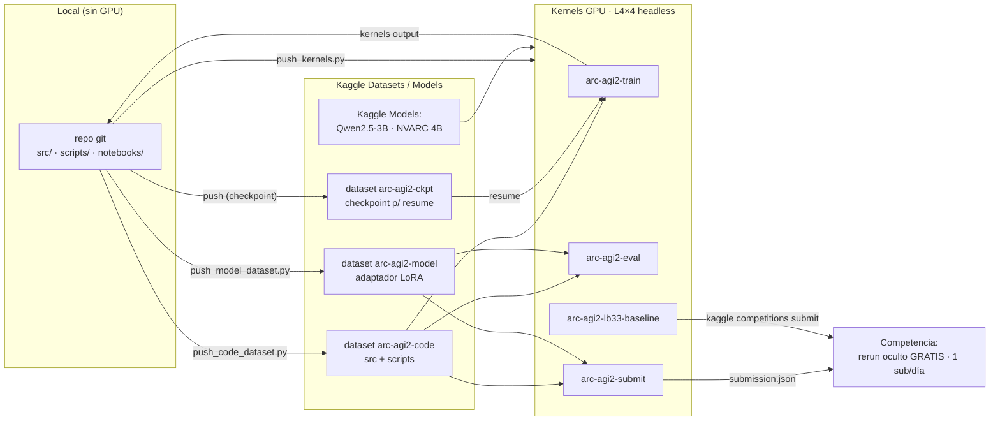

# ARC Prize 2026 — ARC-AGI-2

Solución para la competencia de Kaggle [ARC Prize 2026 — ARC-AGI-2](https://www.kaggle.com/competitions/arc-prize-2026-arc-agi-2).

> **Objetivo:** resolver tareas de razonamiento abstracto (grids de colores) prediciendo
> exactamente 2 outputs por cada input de test. Se acierta si **cualquiera** de los 2
> coincide exactamente con la verdad. El score final es el promedio sobre todos los test outputs.

## Reglas clave de la competencia (resumen)

| Aspecto | Detalle |
|---|---|
| Tipo | **Code competition** — se entrega un **Kaggle Notebook** que corre el modelo |
| Internet en evaluación | **NO** hay acceso a internet durante el scoring → todo debe ir empaquetado (modelo + pesos + código) |
| Runtime | Límite de tiempo de ejecución del notebook (≈12 h; el HW/compute se confirma en la página de reglas) |
| Métrica | `pass@2` por test output, promediado |
| Open source | El código y método deben publicarse con licencia permisiva para optar a premios |
| Premios | ~$700k total: Progreso (~$275k), Grand Prize por writeup (~$275k), Bonus $150k al alcanzar 85% |

> ⚠️ Las reglas exactas (HW, runtime, licencia aceptada) deben confirmarse logueado en
> la [página de reglas](https://www.kaggle.com/competitions/arc-prize-2026-arc-agi-2/rules).
> La distinta edición **ARC-AGI-3** sí permite APIs/internet; **ARC-AGI-2 NO**.

## Datos

Los datos de la competencia **NO** se versionan en este repo (ver `.gitignore`). Para descargarlos:

```bash
python scripts/download_data.py
```

Estructura (en `data/`):

- `arc-agi_training_challenges.json` — 1000 tareas de entrenamiento (con soluciones aparte).
- `arc-agi_training_solutions.json`
- `arc-agi_evaluation_challenges.json` — 120 tareas públicas de evaluación.
- `arc-agi_evaluation_solutions.json`
- `arc-agi_test_challenges.json` — copia pública del set de test (el privado real está oculto).
- `sample_submission.json` — formato de entrega: `{task_id: [{"attempt_1": grid, "attempt_2": grid}, ...]}`.

## Estrategia

Estrategia de **dos vías convergentes** (desde 2026-07-11; detalle en
[`docs/STRATEGY.md`](docs/STRATEGY.md) y auditoría en [`docs/LB33_AUDIT.md`](docs/LB33_AUDIT.md)):

- **Vía A — Baseline LB33/NVARC (~33% LB):** el checkpoint open-source del 1º puesto 2025
  (`sorokin/qwen3_4b_grids15_sft139`, Apache 2.0) con su pipeline público de TTT + DFS,
  **auditado limpio** de hardcode/leakage. Es el control a superar, no solo a igualar.
- **Vía B — Pipeline propio (`src/arc/`):** LLM pequeño + LoRA SFT + TTT por tarea +
  inferencia multi-candidato con **scoring por log-verosimilitud augmentada** + runner
  multi-GPU con presupuesto por tiers. Aporta los *injertos* que LB33 no tiene (cobertura
  bajo presupuesto, selección de attempts) y, a medio plazo, un segundo modelo limpio para
  ensemble y validación.



> ⚠️ **Validación:** el checkpoint NVARC **incluyó el eval público en su SFT** → nunca medir
> mejoras contra `arc-agi_evaluation_challenges.json` con ese modelo. Held-out limpio: split
> reservado del training set + tareas sintéticas propias + leaderboard (1 submission/día gratis).

## Arquitectura y conectores en Kaggle

Sin GPU local: todo corre **headless** en kernels de Kaggle (sin sesiones interactivas, que
queman quota). El repo se conecta a Kaggle vía datasets/kernels; el rerun de la submission
sobre el set oculto es gratis.



Kernels definidos en `scripts/push_kernels.py` (`train`/`eval`/`submit`/`lb33`), todos
pusheados headless por CLI con la imagen Docker pineada y `machine_shape: NvidiaL4`.

> **Nota sobre el modelo:** modelos pequeños (3B–4B) son los viables aquí: MoEs grandes no
> caben offline ni permiten TTT por-tarea dentro de las ~12 h. El ganador 2025 usó ~4B.

## Estructura del repo

```
src/arc/            Paquete Python: carga de datos, serialización, augmentación, métrica
scripts/            Utilidades CLI (descarga de datos, preparación de dataset de fine-tune)
docs/               Notas de estrategia y diseño
notebooks/          Notebook(s) de entrega para Kaggle
data/               Datos de la competencia (NO versionado)
```

## Setup

```bash
python -m venv .venv && .venv\Scripts\activate   # Windows
pip install -r requirements.txt
# credenciales Kaggle en .env (KAGGLE_API_TOKEN, kaggle_username)
python scripts/download_data.py
```

## Licencia

MIT (ver [`LICENSE`](LICENSE)) — licencia permisiva acorde con el requisito de open source de la
competencia. Confirmar en las reglas si exigen CC0/MIT-0.
