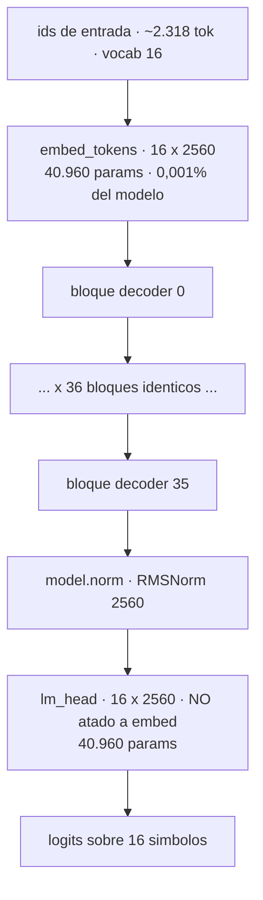
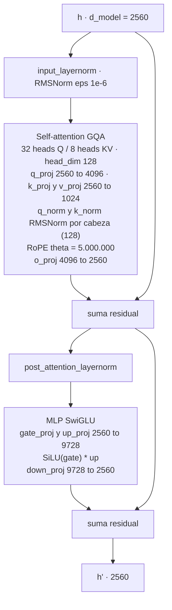
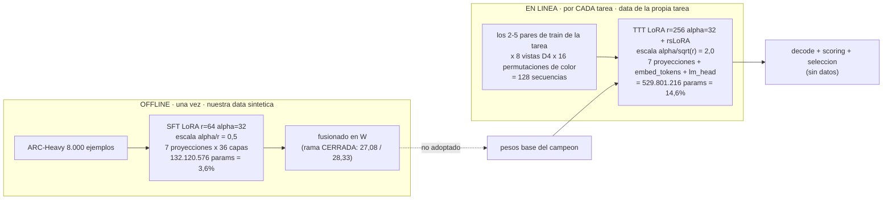
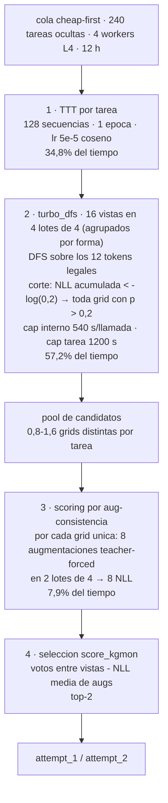

# Arquitectura del campeón y mapa de intervención

Qué es exactamente el modelo que corre en el kernel de 30.14%, dónde inyecta nuestra data de
entrenamiento, y qué superficie queda sin tocar. Documento de análisis — todos los números
salen de artefactos verificables, no de memoria.

**Procedencia de los datos de este documento**

| Dato | Fuente |
|---|---|
| Shapes, nº de capas, rope, vocab | `config.json` del modelo (cacheado del audit del 14-ago) |
| Nombres y tamaños de tensores | cabecera del `model.safetensors` (2B, misma familia) |
| Módulos que tocó nuestro SFT | cabecera del `adapter_model.safetensors` del 4B (528 MB, D4) |
| TTT, decode, scoring, selección | código real de [lb33_graft.ipynb](../notebooks/lb33_graft.ipynb) (celdas `arc_solver.py`, `arc_decoder.py`) |
| Split de tiempo, pools, umbrales | [SPEED_PLAN.md](SPEED_PLAN.md) §5 (smoke B en L4×4, benches Colab) |
| Longitudes de prompt | medición local sobre `data/arc-agi_evaluation_challenges.json` (16-ago) |

---

## 1. El tokenizador: 16 símbolos, 1 token = 1 celda

Lo primero que hay que entender, porque condiciona todo lo demás: **este no es un LLM con
vocabulario de lenguaje**. Sorokin recortó el vocabulario de Qwen3 de 151.936 a **16 tokens**.

| id | token | rol |
|---|---|---|
| 0–9 | `0`…`9` | los 10 colores ARC — **un token por celda** |
| 10 | `Ċ` | salto de línea = fin de fila |
| 11 | `user` | marca de rol (entrada) |
| 12 | `assistant` | marca de rol (salida) |
| 13 | `<\|endoftext\|>` | padding |
| 14 | `<\|im_start\|>` | inicio de turno |
| 15 | `<\|im_end\|>` | fin de turno = EOS |

Formato de una tarea (ChatML sobre grids planas):

```
<|im_start|>user\n<grid_in_1><|im_end|><|im_start|>assistant\n<grid_out_1><|im_end|>   ← par de train 1
...                                                                                     ← pares 2..n
<|im_start|>user\n<grid_test><|im_end|><|im_start|>assistant\n                          ← query (a completar)
```

Consecuencias medidas (eval AGI-2, 120 tareas):

- Prompt **mediano 2.318 tokens**, medio 2.548, p99 7.626.
- Una grid de 30×30 = **929 tokens** (900 celdas + 29 saltos) → `max_new_tokens = 931`.
- El tope de contexto (`max_seq_length = 8192`) recorta demostraciones en **solo 2/120 tareas
  (1,7%)**, y les quita 1 ejemplo. → **la truncación NO es una palanca** (medido hoy; descarta
  la hipótesis antes de gastar en ella).

---

## 2. El modelo: Qwen3-4B con vocabulario de grids



Cada uno de los 36 bloques (todos `full_attention`, sin sliding window):



Presupuesto de parámetros (derivado del `config.json`, verificado contra los tensores del 2B):

| Componente | Shape | Params | Nota |
|---|---|---|---|
| `embed_tokens` | [16, 2560] | 40.960 | la "tabla de símbolos" |
| `q_proj` | [4096, 2560] | 10.485.760 | ×36 |
| `k_proj` / `v_proj` | [1024, 2560] | 2.621.440 c/u | GQA: 4 Q por KV |
| `o_proj` | [2560, 4096] | 10.485.760 | ×36 |
| `q_norm` / `k_norm` | [128] | 128 c/u | RMSNorm por cabeza (propio de Qwen3) |
| `gate/up/down_proj` | [9728, 2560] | 24.903.680 c/u | ×36 — **el 74% del modelo vive aquí** |
| norms de bloque | [2560] | 2.560 c/u | ×2 por bloque |
| **total por bloque** | | **100.930.816** | |
| **×36 bloques** | | **3.633.509.376** | |
| `model.norm` + `lm_head` | | 43.520 | |
| **TOTAL** | | **≈ 3.634 M** | bf16 → 7,3 GB en VRAM |

Dato clave para lo que sigue: **la tabla de símbolos (embed + lm_head) son 81.920 parámetros,
el 0,002% del modelo**. Todo el conocimiento vive en las 36 capas; la tabla solo ancla qué
significa cada color.

---

## 3. Dónde inyecta nuestra data de entrenamiento

Solo hay **dos** puntos de inyección en todo el sistema. El resto del pipeline (decode,
scoring, selección) es algoritmo sin datos.



La diferencia entre los dos puntos es más grande de lo que parece:

| | SFT (nuestra data, D4) | TTT (producción, por tarea) |
|---|---|---|
| Rank | 64 | 256 |
| Escala efectiva | α/r = **0,5** | α/√r = **2,0** (rsLoRA) → **4× más fuerte** |
| Módulos | 7 proyecciones | 7 proyecciones **+ embed_tokens + lm_head** |
| Params entrenados | 132 M (3,6%) | **530 M (14,6%)** |
| Datos | 8.000 tareas ajenas | 128 secuencias de **esta** tarea |
| Duración | 3,2 h una vez | ~313 s por tarea (34,8% del presupuesto) |

**Observación de saturación de rango** (esto explica mucho): `embed_tokens` y `lm_head` son
matrices [16, 2560] — su rango máximo posible es **16**. Un LoRA de r=256 sobre ellas es
**rango completo**: el TTT puede reescribir por completo el significado de cada símbolo de
color en cada tarea. Es exactamente el mecanismo que hace que la augmentación por permutación
de colores funcione. En cambio, sobre `q_proj` (4096×2560) r=256 es solo ~10% del rango máximo.

Corolario incómodo y probablemente importante: **nuestro SFT nunca tocó la tabla de símbolos**
(el adapter de 528 MB no contiene `embed_tokens` ni `lm_head` — verificado tensor a tensor), y
el TTT la reescribe entera después. Es un candidato serio a explicar por qué la ganancia del
SFT se lavó parcialmente sobre el TTT (lo que ya midió D2-bis).

---

## 4. El pipeline por tarea (donde se gasta el tiempo)



Restricción dominante: **el campeón nunca vacía su cola**. ~900 s por tarea × 60 tareas por
worker ≈ 15 h > 11,8 h disponibles → **~20% de las tareas jamás se procesan** y salen como
placeholder `[[0]]`.

### 4-bis. Una fuente de no-determinismo escondida en el scoring

El scoring construye sus 8 augmentaciones con `aug_dataset.augment(seed=hash(bk) % 1024**2)`.
`hash()` sobre strings en Python 3 está **salteado por proceso** (`PYTHONHASHSEED` aleatorio si
no se fija). Consecuencias:

- Dentro de una corrida, el seed es constante por tarea → **el prompt de las 8 augmentaciones
  es idéntico para todos los candidatos de esa tarea** (solo cambia la respuesta). Eso es lo
  que habilita la palanca nº 1 de la §6.
- Entre corridas, el seed **cambia** → distintas permutaciones de color → distintos NLL →
  el orden del top-2 puede cambiar. **El mismo kernel no es reproducible.**

Esto es consistente con lo observado: dos tiradas del mismo kernel 2B dieron **19,86 y 21,25**
(1,39 puntos de diferencia sin cambiar una línea). Implicación metodológica para todos los
A/B futuros: **diferencias menores a ~1,4 puntos no son concluyentes con una sola tirada.**
Fijar `PYTHONHASHSEED` (o sustituir `hash()` por un hash estable tipo `md5`) no sube el score
por sí mismo, pero convierte cada submission en una medición comparable — que es el recurso
más escaso del proyecto.

---

## 5. Descomposición del score: dónde está realmente el techo

Con los números medidos, el 30,14% se factoriza así:

```
score ≈ cobertura × (GT alcanzable en el pool) × (la selección la elige)
30,1%  ≈   0,80    ×          0,42             ×        ~0,90
```

- **cobertura 0,80** — límite de 12 h (medido: coverage-limited).
- **GT-en-pool 0,42** — el bench de umbral dio 5/12 a `-log(0,2)`, y **el techo se estanca en
  6/12 aunque se abra el umbral a `-log(0,01)`**: en la mitad de las tareas el modelo no puede
  producir la respuesta a ningún umbral.
- **selección ~0,90** — el smoke real confirma que cuando la GT está en el pool, `score_kgmon`
  la pone en el top-2 (y el `attempt_2` **sí se usa**: 4 de 5 subtareas del smoke tienen segundo
  intento distinto; en el fusionado el acierto vino por `attempt_2`).

Esto acota cada familia de trabajo, y es el dato más accionable del documento:

| Palanca | Techo teórico si fuera perfecta |
|---|---|
| **Velocidad/cobertura** (0,80 → 1,00) | 30,1 → **37,7** (+7,5 pts) |
| **Selección** (0,90 → 1,00) | 30,1 → **33,5** (+3,3 pts) |
| **GT-en-pool** (0,42 → 0,84) | 30,1 → **60,3** (×2) |

Todo el trabajo de velocidad del proyecto compite por un máximo de +7,5 puntos, y ya
capturamos parte. **El premio real es GT-en-pool**, y el barrido de umbral demuestra que no se
compra con decodificación más ancha: es el modelo el que no sabe generar la respuesta. Por eso
la rama de inducción/híbridos es la única con techo alto, y por eso el mapa SOTA dice que la
transducción pura satura ~40%.

---

## 6. Superficie de intervención

### Cerrado con evidencia (no volver sin dato nuevo)

| Superficie | Veredicto | Evidencia |
|---|---|---|
| Volumen y fuente de datos SFT | plateau quíntuple 7-8/24 | 5 distribuciones distintas, D2/D3/claudegen |
| Capacidad (4B fusionado) | 27,08 / 28,33 vs 30,14 | A/B en LB, rama cerrada 16-ago |
| Tiempo por tarea (cap 600/1200) | ambas direcciones peor | RESULTS.md: 600 → smoke 1,5/3; 1200+TTT → 28,06 |
| Fusión de lotes de decode (`dfsbatch`) | speedup 1,05× y **39,3 GB > 22 GB** | bench Colab A-bis |
| Umbral DFS más ancho (`dfswide`) | +1/12 GT por +75% tiempo → neto regresivo | bench A-quinquies |
| `scoring4` en solitario | 7,9% del tiempo < gate 15% | smoke B |
| Truncación de contexto | 2/120 tareas (1,7%) | medición local 16-ago |
| Diversidad del `attempt_2` | ya se usa (4/5 subtareas) | submission.json del smoke |
| Ensemble 2B/TRM | el 4B nunca cede cómputo sobrante | RESULTS.md |

### Abierto y sin medir

Ordenado por (evidencia a favor) ÷ (coste de probarlo):

1. **Caché de prefijo KV en el scoring** — *exacto, sin pérdida de calidad*.
   Las 8 secuencias de augmentación de una tarea usan **el mismo prompt para todos los
   candidatos** (`seed = hash(bk)`, solo cambia la respuesta), y el prompt es el **92% de los
   tokens** (2.318 vs ~200). Hoy se recomputa entero por candidato. Cachear el prefijo una vez
   por tarea reduce el scoring ~6-8× → libera ~6-7% del presupuesto → ~6% más cobertura
   (≈ +0,7-1,0 pts en régimen coverage-limited). A diferencia de `scoring4`, **no aproxima
   nada**: los NLL resultantes son idénticos y eso se verifica comparando contra la
   implementación actual. Riesgo: implementación (padding/position_ids), no calidad.
2. **Umbral DFS más ESTRECHO** (`p > 0,3` en vez de `p > 0,2`) — el barrido solo exploró abrir
   el umbral (más caro). Cerrarlo es la dirección barata: menos ramas → decode más rápido →
   cobertura. El bench ya existe (`scripts/colab_dfs_threshold.py`), solo cambia un número. El
   riesgo es perder GT del pool; el bench mide exactamente eso antes de gastar Kaggle.
3. **Cap de ancho de haz** — en `turbo_dfs` hay un `[:5]` **comentado** en el ordenamiento de
   candidatos: no hay tope de ramificación por posición. Acotarlo recorta la cola de tareas
   patológicas (decode medido 27→790 s) sin tocar el caso común. Es la forma limpia de la
   "reasignación adaptativa de presupuesto" que quedó pendiente.
4. **Alcance del TTT** — 530 M parámetros entrenados con 128 secuencias es enorme. Sin medir:
   LoRA solo en las capas altas, o solo en MLP, o rank menor. Ataca el 34,8% del presupuesto.
   (`ttt8`, que baja augmentaciones, salió rojo sobre la base del campeón — pero eso es el eje
   *datos*, no el eje *alcance*.)
5. **Tabla de símbolos en el SFT** — incluir `embed_tokens`/`lm_head` (82 K params, coste ~0)
   en un SFT futuro, para que la re-alineación de dominio no dependa solo de las proyecciones
   que el TTT luego pisa. Solo relevante si se reabre una rama de entrenamiento.
6. **Inducción / híbrido** — la única palanca que ataca GT-en-pool (el ×2). 1.5B dio 0/24;
   Coder-3B se perdió por infra. Es la rama con techo alto y coste alto.

---

## 7. Cola recomendada

| # | Trabajo | Coste | Ganancia esperada |
|---|---|---|---|
| 0 | Fijar `PYTHONHASHSEED` / hash estable en el seed de scoring | 1 línea | 0 pt, pero hace comparables todas las mediciones siguientes |
| 1 | Caché de prefijo KV en scoring (+ test de equivalencia numérica) | Colab gratis + 1 smoke | +0,7-1,0 pt, sin riesgo de calidad |
| 2 | Barrido de umbral hacia arriba (0,25 / 0,3) en el bench | Colab gratis | decide si hay +0,5-1 pt más |
| 3 | Cap de ancho de haz sobre la cola patológica | Colab gratis | acota el peor caso |
| 4 | A/B en Kaggle del paquete 0+1+2+3 | 1 submission | acumulativo — y por encima de la banda de ruido de 1,4 pt |

Los tres primeros se diseñan y miden **sin gastar quota de Kaggle**, que es la restricción
dura. Ninguno toca el modelo: el campeón sigue siendo el 4B original de sorokin.
