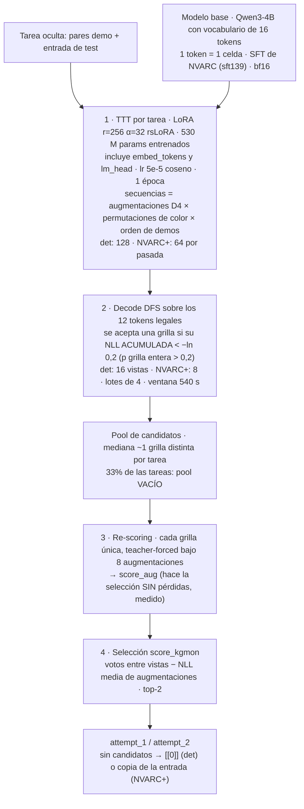
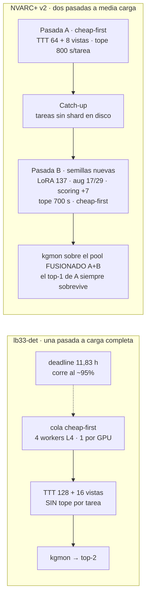
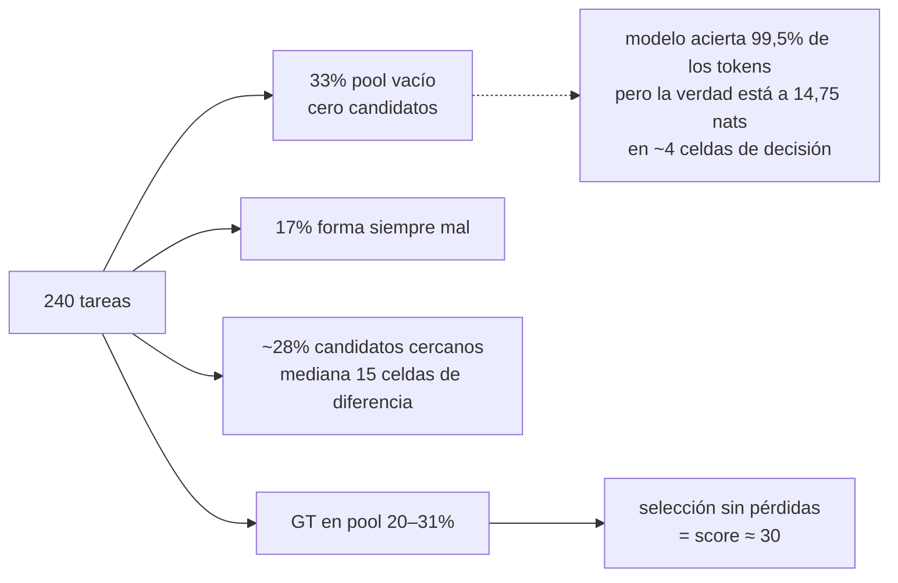

# PANORAMA — qué hace el sistema del mejor score, qué está probado y qué no (17-oct-2026)

> Documento de referencia vivo. Sustituye a `ARCHITECTURE.md` (que describe el 30,14 de agosto y
> tiene cifras superadas, ver §5). Todo lo que sigue sale de los notebooks reales
> (`notebooks/lb33_det.ipynb`, `notebooks/nvplus.ipynb`) y de las submissions registradas en Kaggle.

## 0. Qué es "el mejor score"

| sistema | muestras LB | media | σ | nota |
|---|---|---|---|---|
| **NVARC+ v2** (`nvplus`, público de `luxluxshan`, sin cambios) | 29,44 · **30,97** | 30,21 | ≈1,1 (n=2) | el **30,97 es el máximo puntual** de toda la campaña |
| **`lb33-det`** (nuestro campeón) | 31,11 · 30,69 · 30,28 | **30,69** | **0,415** (n=3) | mejor media y canal 2,6× más estrecho |

El 30,97 es **una tirada** de un sistema cuya media es 30,21: está dentro del ruido de ambos (el
cuanto es 1/240 = 0,4167 pt; 30,97 − 30,69 = 0,28 pt < 1 tarea). **No hay un campeón
estadísticamente nuevo.** Los dos comparten el mismo modelo y el mismo núcleo; difieren en cómo
reparten las 12 horas (§2).

Marco externo (leaderboard 16-oct): Tufa Labs **88,06**, Yi-Chia Chen **83,89** (era 55,14 el 1-oct),
rabbithole 80,56, nvbanana 79,17, `_hans` 71,81; el pelotón público ronda 34–39. Nadie de arriba ha
publicado método (el track AGI-2 no tiene hitos de open-source; los writeups llegan 7 días tras el
2-nov).

## 1. Qué hace el sistema (por tarea)

## 2. Cómo reparten las 12 horas los dos sistemas

Verificado hoy contra el código (`diff` de configuración):

| parámetro | `lb33-det` | NVARC+ v2 |
|---|---|---|
| rango LoRA / α / lr / épocas | 256 / 32 / 5e-5 / 1 | **idéntico** |
| umbral DFS | −ln 0,2 | **idéntico** (`min_prob`) |
| scoring | 8 augmentaciones en 2 lotes de 4 | **idéntico** |
| secuencias de TTT | 128 (`augment(n=16)`) | **64** (`n_train_aug=8`) |
| vistas de decode | 16 (`augment(n=2)`) | **8** (`n_eval_aug=1`) |
| tope por tarea | **ninguno** (quitado el 2-sep) | **800 s A / 700 s B** (`task_cap`, al inicio de cada lote) |
| pasadas | 1 | A + catch-up + B |
| semilla de scoring | md5 estable | `stable_seed` + `PYTHONHASHSEED=0` (equivalente) |
| imagen Docker | `…320043…868` | **idéntica** |
| `max_seq_length` | 8192 | 8192 |

## 3. Panorama de lo probado y lo no probado

### 3.1 Probado en el LB (n=240, un injerto por brazo)

| qué | LB | lectura |
|---|---|---|
| campeón `lb33-det` | 31,11 · 30,69 · 30,28 | **nivel de referencia** (σ 0,415) |
| NVARC+ v2 | 29,44 · 30,97 | empate de nivel, σ mayor; no adoptado |
| sin TTT | 9,58 | el TTT vale **+20,6 pt** (2/3 del score) |
| TTT a media época | 26,39 | recortar el TTT resta |
| rango 64 / 512 | 29,72 / 24,31 | 64 pierde capacidad; 512 cae del acantilado de reloj (−15 tareas) |
| orden de demos fijado (ttford) | 25,69 | −5 pt: el orden aleatorio es estructural |
| cheap-first + tope de longitud (stack) | 29,44 | revertido |
| 4B SFT fusionado (escala) | 27,08 · 28,33 | pools ricos encarecen y colapsan cobertura |
| 2B (con/sin ARC-Heavy) | 18,33 · 19,86 · 21,25 | 2B memoriza eval público: inválido como vehículo |
| ensemble de selección kgmon+probmul | 29,31 | la selección no es palanca |

### 3.2 Probado offline (0–3 h-cuota por pregunta, con prerreg)

| pregunta | veredicto | dato clave |
|---|---|---|
| ¿dónde se pierde el score? (`autopsia`, `strat`) | GT-en-pool 20–31%; selección **sin pérdidas** | 33% pool vacío · 17% forma siempre mal · 17% «casi» ≥95% celdas |
| ¿qué rechaza la regla de aceptación? | sesgo contra rejillas grandes | `p(grilla entera) > 0,2` ⇒ impuesto exponencial al tamaño |
| haz como respaldo (`haz`, `haz2`) | recupera ~2/18 pero **+29,1% de reloj** vs techo +4,8% | déficit→ancho ≈ exp(déficit): instrumento validado |
| ¿el hueco es OOD? (Fase 0) | sí, creciente: 0,500 → 0,750 → 1,161 | p=2e-8; el exceso es **contenido**, no escala |
| inducción con DSL de rejilla / de objetos | 0% en 700 tareas AGI-2 | las reglas dependen de **relaciones entre objetos** |
| cambio de base (3.5-4B, MoE, 27B, 2B) | todas cerradas | 2B empata pero su reloj liberado no tiene comprador |
| SFT con datos del training de ARC | vacuo | sft139 lo **memoriza** (NLL/token 0,0039) |
| SFT con puzzles Nemotron (`nemvac`) | vacuo para los grandes | 74% greedy exacto sin TTT; r=0,08 |
| ¿escala o novedad? (`rearcvac`) | **novedad de regla** | regla conocida 78% → ×5,75 escala 67% → regla nueva 10% |
| dos TTT independientes (`ttt-2hip`) | unión **+0** | Jaccard 0,26: diversos y ambos equivocados (n=12, decil barato) |
| proxy de medida | NLL/celda **post**-TTT predice GT-en-pool | Spearman −0,430; pre-TTT no |

### 3.3 NO probado (lista honesta)

| # | qué | por qué importa | coste de probarlo |
|---|---|---|---|
| U1 | **Runtime y cobertura reales** de la corrida oculta (nuestra y de NVARC+) | nunca se observó: «95% del deadline» se **infirió** del LB (r512). ¿Terminó la pasada B? ¿cuántas tareas quedan en placeholder? | **0**: leer «Run time» de las submissions `56688393` y `56742827` en la UI de Kaggle (el CLI no lo expone) |
| U2 | **Atribución dentro de NVARC+**: media carga sola, pasada B sola, fusión, tope 800/700 | hoy solo existe el compuesto (30,21) | 1 brazo por componente = 1 slot y ~1,2 h-cuota cada uno |
| U3 | Si el **tope por tarea** explica la σ de NVARC+ | hipótesis respaldada por código y por el 2-sep, **no medida**; ojo: el 2-sep agrupó dos injertos (semilla md5 + sin tope), el +4 y el estrechamiento **no se pueden atribuir** al tope en solitario | 1 slot: NVARC+ con tope alto; σ solo se lee con n≥2 |
| U4 | Bug de NVARC+: tarea procesada con pool vacío no escribe shard ⇒ el catch-up la repite con las mismas semillas | preparado (`nvplus-a1`), **nunca ejecutado**; suposición «mismas semillas ⇒ mismo vacío» sin comprobar (la GPU no es determinista) | 1 slot + 1,2 h-cuota |
| U5 | **El hueco con el pelotón**: mismo modelo, notebooks públicos en 33,89–38,89 vs nuestro ~30 | es la mayor diferencia sin explicar (~3–8 pt = 7–19 tareas) | la hipótesis «imagen Docker» quedó **refutada hoy** (§5); sin hipótesis nueva |
| U6 | **Inducción por LLM** (que el modelo escriba un programa Python y se verifique contra las demos) | los DSL a mano murieron, pero **no se ha probado un LLM generando código**; es lo que insinúan los datos de Nemotron (prompt «escribe `transform`»). Única vía con techo alto | puerta de 20 tareas (§6, P1) |
| U7 | Generador alternativo `qwen3-8b-nemotron77k` | otro modelo, otros datos; coste ~18K tokens/respuesta | puerta de 20 tareas (§6, P1) |
| U8 | Búsqueda por tarea más profunda dentro de B (haz solo en pools vacíos) | el haz costaba +29% en UNA pasada; dentro de B el tiempo ya está pagado | depende de U2 |

## 4. Dónde se pierde el score (para orientar cualquier idea nueva)

El déficit no es escala ni datos de reglas conocidas: es **inducir una regla nueva en el test** (§3.2).

## 5. Auditoría de congruencia (17-oct) — inconsistencias halladas y qué se hizo

| # | hallazgo | acción |
|---|---|---|
| 1 | `ARCHITECTURE.md` describe el 30,14 con «cobertura 0,80», «GT-en-pool 0,42», «~20% jamás se procesan», un tope por tarea 1200 s y una sección «Abierto y sin medir» que luego se midió o murió. Hoy: cobertura 100% (sin tope), GT-en-pool 20–31% | **banner de «superado» añadido** en `ARCHITECTURE.md` apuntando aquí |
| 2 | `PLAN.md` decía «quitar el tope de reloj: +4 tareas». El 2-sep se subieron **dos injertos juntos** (semilla md5 + sin tope) y el LB no atribuye cambios agrupados | corregido en `PLAN.md`: el +4 es del par, no del tope |
| 3 | Memoria `arc-leaderboard-landscape`: «única diferencia de entorno: imagen Docker 31090». **Refutado hoy**: `mikelou1/…lb33-89-minimal-perfpatch`, `koushikrudra/failed-in-aimo` y `luxluxshan/arc2-nvarc-v1` declaran **exactamente nuestro digest BYOD** | corregida la memoria; U5 sigue abierto sin hipótesis de entorno |
| 4 | `working_note_en/es.md` titulan «A phantom gap, **resolved**», pero el texto dice «no pudimos identificar la causa» | retitulado «**not resolved** (abandoned)» |
| 5 | Cifras de la autopsia («33% pools vacíos») vienen de **20 tareas a carga completa**; NVARC+ corre a media carga y su tasa de vacíos puede ser mayor | anotado como supuesto en U4 |
| 6 | Se cerró `nvplus` con una muestra (29,44) antes de tener la σ de NVARC+; la segunda cambió la lectura | regla recogida en memoria: antes de cerrar un baseline ajeno, n≥2 |

Coherencia que **sí** se verificó: núcleo idéntico entre los dos sistemas (§2), los umbrales
prerregistrados de `nvplus` se aplicaron tal cual, el ledger de la semana 29-sep (1,7 h-cuota) y que
ninguna de las líneas cerradas se reabrió sin dato nuevo.

## 6. Dónde se deja y qué probar a continuación

**Estado:** `lb33-det` queda como submission final candidata (mejor media y σ). NVARC+ queda como
alternativa **equivalente** y como referencia de lo que hace el pelotón. Ninguna submission pendiente.
Cuota: las últimas 1,7 h-cuota gastadas (29/30-sep) son de la semana anterior; el estado actual del pool compartido con agi-3 no está verificado, así que se comprueba antes de lanzar P1.

| prioridad | prueba | coste | decisión que habilita |
|---|---|---|---|
| **P0** | **U1**: leer el «Run time» de las dos corridas de NVARC+ en la UI de Kaggle | 0 | si la pasada B terminó con holgura, hay reloj libre real que gastar; si no, NVARC+ ya iba justo |
| **P1** | **Puerta de inducción/8B (U6+U7)**: `qwen3-8b-nemotron77k` sobre las ~20 tareas de `strat` (ya tienen resultado del campeón ⇒ pares), `max_new_tokens` 24K, tope de pared 40 min. Prerreg: **≥3 tareas resueltas que el campeón falla** ⇒ merece ingeniería (vLLM/FP8); 1–2 ⇒ marginal; 0 ⇒ línea muerta | ~2,5 h-cuota | única vía con techo alto; si pasa, hay que diseñar su sitio en el reloj (sustituir la pasada B) |
| P2 | **U3/U4** con un solo brazo: NVARC+ con `nvplus-a1` (marca de procesada + B dirigida) | 1 slot + 1,2 h-cuota | si ≥ 31,5 sobre ambas muestras, A1 es real; si no, NVARC+ se cierra |
| P3 | **Paper Track** (9-nov): esta anatomía medida (autopsia, escalera OOD, novedad vs escala, cierres) | 0 | entregable seguro |
| — | **No probar**: más datos sintéticos de reglas conocidas, cambio de base, DSL a mano, haz como respaldo en una pasada, rangos/épocas/orden del TTT | — | cerrados con medición (§3.2) |
