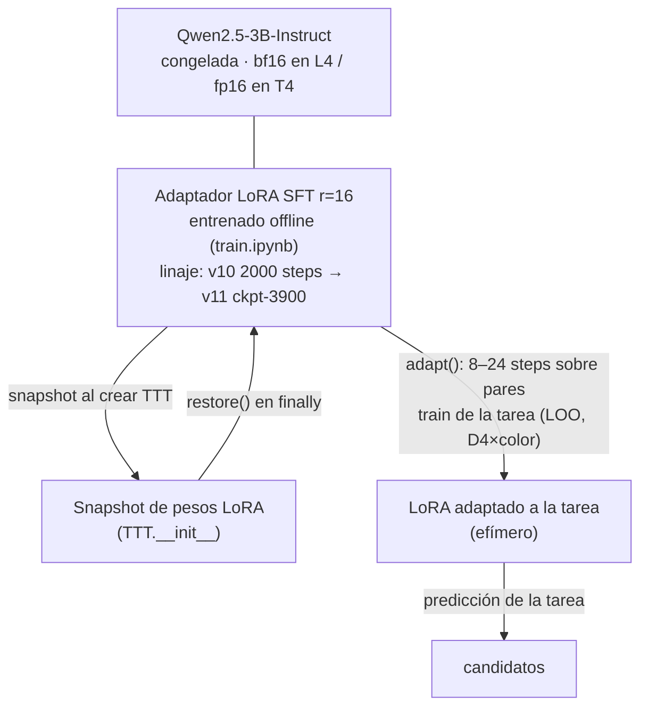
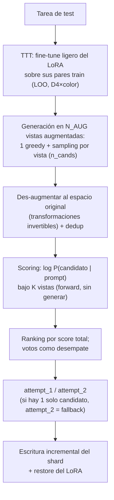
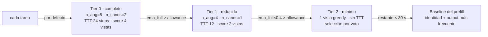

# Estrategia — ARC Prize 2026 (ARC-AGI-2)

## Contexto y restricciones que moldean la solución

- **Sin internet en evaluación** → el modelo y sus pesos viajan dentro del notebook / como
  Kaggle Dataset adjunto. Nada de llamar APIs (eso es ARC-AGI-3, otra pista).
- **~12 h de runtime** sobre GPU de Kaggle → presupuesto de cómputo por tarea muy ajustado.
  Esto favorece **modelos pequeños (~0.5B–7B)** con adaptación rápida frente a modelos gigantes.
- **pass@2 exacto** → no hay crédito parcial; el grid debe coincidir celda a celda.
- **ARC-AGI-2 es deliberadamente anti-memorización** → soluciones que solo memorizan patrones
  del train fallan. Hace falta *adaptación por tarea* (test-time training) y razonamiento composicional.

## Qué enseñó el ARC Prize 2025 (calibración contra el SOTA real)

Resultados del Kaggle 2025 sobre el set privado de ARC-AGI-2:

| Puesto | Equipo | Score | Receta |
|---|---|---|---|
| 1º | **NVARC** (NVIDIA) | **24.03%** | Ensemble de un modelo **~4B** estilo-ARChitects con **TTT** + componentes **TRM**, alimentado por un **corpus sintético masivo y diverso** (generación por etapas, descomposición de conceptos, modelos Qwen). ~$0.20/tarea. |
| 2º | ARChitects | 16.53% | LLM de difusión enmascarada **2D-aware** con auto-refinamiento recursivo y **scoring por perspectivas** (puntuar candidatos bajo vistas augmentadas). |
| 3º | MindsAI | 12.64% | Pipeline TTT muy ingenierizado: TTFT, ensembles de augmentación, tokenizer dropout. |

Papers premiados: **TRM** (7M params, ~8% ARC-AGI-2, refinamiento recursivo de la respuesta) y
CompressARC (76K params, MDL puro por tarea). Tema transversal 2025: **refinement loops**
(generar candidatos + señal de verificación + iterar).

**Conclusiones para nosotros:**
1. Nuestra receta base (LLM pequeño + LoRA + sintético + TTT + augmentación) **es la correcta** —
   es exactamente la familia del 1º y 3º puesto. La organización dice que la brecha de accuracy
   está "bottlenecked by engineering": ganan los detalles, no un cambio de paradigma.
2. El *edge* del ganador fue la **escala y diversidad del corpus sintético** ("mover el
   razonamiento complejo offline, al pipeline de datos"), no un modelo más grande.
3. La **selección de candidatos por verosimilitud bajo vistas augmentadas** (scoring, no voto
   simple) es un componente probado de los dos primeros puestos.
4. 85% (bonus) sigue lejísimos del SOTA (24%). Objetivo realista: **top-8 del Progress
   leaderboard** (todos cobran premio) + **writeup sólido** para el Grand Prize.

## Hardware: Kaggle L4×4 (96GB, offline)

Esta competencia da acceso a **L4×4 = 96GB de VRAM**, pero con condiciones:
- **Internet OFF obligatorio** en toda sesión L4 (también entrenamiento) → modelo base y deps
  desde Kaggle Models/Datasets adjuntos; sin descargas HF ni `pip install` con red.
- Consume **quota al doble** que T4×2/P100; solo para notebooks adjuntos a esta competencia.
- Desde CLI se selecciona con `machine_shape: "NvidiaL4"` (`push_kernels.py --accelerator NvidiaL4`).
- No hay GPU local → todo el cómputo va en kernels de Kaggle (`scripts/push_kernels.py`),
  en **sesiones ≤12h con checkpoint-resume** (el adapter se versiona en el dataset
  `arc-agi2-model` y se retoma en la siguiente sesión).

**Quota y submissions (trucos importantes):**
- El **rerun de scoring de una submission NO gasta quota GPU** — corre en cómputo de Kaggle
  aunque el notebook tenga GPU asociada. Solo la fase "Save & Run All" (guardar la versión)
  consume quota propia. Estrategia: pagar la quota una vez para guardar una versión correcta
  del `submit`, y **enviar 1 submission por día** (límite) para medir en el leaderboard gratis.
  Reservar siempre ~2h de holgura antes del reset semanal para poder guardar una versión.
- **Nunca abrir sesiones interactivas con GPU**: el editor quema quota mientras esté abierto,
  aunque esté idle. Todo por "Save & Run All" headless (`scripts/push_kernels.py` via CLI) y
  luego inspeccionar el output (`kaggle kernels output`) sin sesión activa — pesos,
  checkpoints y logs quedan en la salida de la versión guardada.

Estado actual: la **inferencia ya corre con 4 workers × 1 GPU** (`arc/runner.py` +
`scripts/infer_worker.py`, sharding de tareas, sin DDP) — ver "Presupuesto de tiempo por
tiers". `train.ipynb` sigue deliberadamente en **1 GPU** (DataParallel/DDP revertidos por
OOM/cuelgues; el resume entre sesiones cubre el throughput de entrenamiento).

## Modelo (por vías)

- **Vía A (baseline):** `Qwen3-4B sft139` de NVARC — **fijo, no se reentrena** (su SFT ya
  incluye el eval público; ver [LB33_AUDIT.md](LB33_AUDIT.md)).
- **Vía B (propio):** **Qwen2.5-3B-Instruct** actual (iterando con LoRA SFT + TTT).
  Ablation pendiente Qwen3-4B vs Qwen2.5-3B/7B (backlog P1); 0.5B/1.5B solo para smokes baratos.
- Llama 4 y MoEs grandes descartados: no caben offline ni permiten TTT por-tarea en 12h.

## Pivote a dos vías (2026-07-11)

Tras medir retornos decrecientes del SFT propio (evals v9/v10: 0 exactas con near-misses
95–97%) y auditar el notebook público **LB33** ([LB33_AUDIT.md](LB33_AUDIT.md) — limpio),
la estrategia pasa a dos vías convergentes: **LB33/NVARC como baseline (~33% LB)** y el
pipeline propio como fuente de *injertos* (cobertura por tiers, selección de attempts) y
de un segundo modelo limpio para ensemble/validación. Diagrama general en el
[README](../README.md#estrategia).

### Modelo y adaptadores (Vía B)

Tres capas de pesos: la base congelada, el adaptador SFT entrenado offline (versionado en
`arc-agi2-model`/`arc-agi2-ckpt`), y la adaptación efímera de TTT que vive solo durante
una tarea (snapshot/restore garantiza cero fuga entre tareas):

En la Vía A (LB33/NVARC) el esquema difiere: no hay adaptador SFT separado (el SFT está
fundido en el checkpoint Qwen3-4B) y el TTT entrena un LoRA **r=256 desde cero por tarea**
(1 época, 128 augmentaciones) — más pesado pero más plástico.

### Inferencia por tarea (Vía B: `src/arc/infer.py` + `runner.py`)

### Presupuesto de tiempo por tiers (`runner.py`)

El shard arranca pre-llenado con la baseline (un crash nunca deja submission inválida) y
ordena tareas de barata a cara. Antes de cada tarea, el *allowance* restante decide el tier
(`allowance` = tiempo restante ÷ tareas restantes; `ema_full` = media móvil exponencial del
costo observado de una tarea en Tier 0):

Esta pieza es el injerto de mayor valor sobre LB33: sus caps fijos dejan `[[0]]` en lo que
no alcanza; con tiers, cada tarea recibe *algo* mejor que un cero seguro.

## Pipeline por fases (re-priorizado tras 2025)

### Fase 0 — Pipeline de entrega (sin ML)  ✅ implementado
`scripts/make_submission.py` produce `submission.json` válido (identidad + output frecuente).

### Fase 1 — Datos + Fine-tune con LoRA  ✅ base implementada → **escalar diversidad (P1)**
1. Serializar tareas a texto (`src/arc/grid.py::format_task_prompt`).
2. **Augmentar masivamente** (`src/arc/augment.py`): 8 simetrías D4 × permutaciones de color
   × leave-one-out. 1000 tareas → cientos de miles de muestras.
3. **Datos sintéticos** (`src/arc/synth.py`): 22 reglas procedurales (incl. `compose` de 2 ops).
   Escalable con `scripts/build_synth_dataset.py`.
4. **[NUEVO] Corpus externos** — el edge de NVARC fue la diversidad, y hay corpus abiertos
   que superan por mucho nuestras 22 reglas:
   - **RE-ARC** (Hodel): generadores procedurales de las 400 tareas de ARC-AGI-1 → muestras
     ilimitadas de la distribución original.
   - **BARC / ARC-Heavy** (~400k tareas generadas por LLM, HuggingFace): diversidad conceptual.
   - **ARC-AGI-1 completo** (800 tareas train+eval): datos de entrenamiento legítimos para
     ARC-AGI-2 (sets disjuntos).
   Descargar localmente → filtrar/deduplicar → subir como Kaggle Dataset (offline-friendly).
5. Entrenar LoRA (`scripts/train_lora.py`, completion-only masking); mezcla real + sintético
   + externos. Validar en `evaluation` (120 tareas) con `scripts/evaluate.py`.

### Fase 2 — Test-Time Training (TTT)  ✅ implementado y activo
`src/arc/ttt.py`: fine-tune ligero del LoRA por tarea sobre sus pares `train` augmentados
(leave-one-out), con snapshot/restore entre tareas. Es la técnica común a los 3 ganadores 2025.
✅ `submit.ipynb` corre con `ENABLE_TTT=True`; el costo por tarea se gobierna con los tiers
del runner (ver "Presupuesto de tiempo por tiers"), no con un flag global.

### Fase 3 — Inferencia multi-candidato + scoring por verosimilitud  ✅ implementado
`src/arc/infer.py::predict_task_scored`: por vista augmentada genera 1 greedy + sampling,
des-augmenta y deduplica; puntúa cada candidato único por su **log-verosimilitud bajo K
vistas** (`score_completions`, un forward pass por vista, sin generar) y rankea por score
total con voto como desempate (`rank_keys`). Esto convierte pass@2 en un problema de *ranking*.
Pendiente (P2): **DFS con umbral de probabilidad acumulada** como generador de candidatos
(portable de LB33: `turbo_dfs`), más barato que muestrear N veces.

### Fase 4 — Ingeniería de runtime  ✅ implementada (`arc/runner.py` + `infer_worker.py`)
4 workers × 1 GPU (shard por tarea, sin DDP), presupuesto por tarea con degradación por tiers
(ver diagrama arriba), y escritura incremental de cada shard con fallback baseline granular.
Es el injerto de mayor valor sobre LB33 (que deja `[[0]]` en lo no alcanzado).

### Fase 5 — Ensemble (stretch, P2)
NVARC ensambló su LLM-TTT con componentes **TRM** (7M params, open source, barato en
inferencia). Opción: entrenar un TRM en sesiones Kaggle y usarlo donde el LLM tiene baja
confianza (score bajo del top-candidato). Solo abordar si las Fases 1–4 están saturadas.

## Disciplina experimental

- Resultados en [`RESULTS.md`](RESULTS.md). Registrar cada corrida: fecha, modelo, datos, flags, score.
- **Held-out limpio (`src/arc/holdout.py`):** el SFT del checkpoint NVARC incluyó el eval
  público (y casi seguro el training) → medir ahí mide **memorización**. Política por vía:

  | Set (`evaluate.py --eval-set`) | Limpio para Vía B | Limpio para Vía A (NVARC) |
  |---|---|---|
  | `evaluation` (público) | ❌ (no entrenar ahí) | ❌ contaminado |
  | `holdout` (105/1000 del training, split determinista md5) | ✅ **si** la Vía B excluye esos IDs del SFT (`build_finetune_dataset.py --exclude-holdout`) | ❌ probablemente contaminado |
  | `synth` (tareas propias jamás publicadas) | ✅ | ✅ (baja señal; solo sanity-check) |

  Señal final para ambas vías: **leaderboard, 1 submission/día**.
- El adaptador Vía B actual (v10/v11) se entrenó con TODO el training → ya "gastado" para
  validación; el próximo SFT debe usar `--exclude-holdout` para habilitar el set `holdout`.
- Ablations mínimas: scoring-vs-voto, ±TTT, ±sintético/±externos, n_aug, tamaño de modelo.

## Hitos (deadline estimado ~nov 2026 — confirmar en las reglas)

| Mes | Objetivo |
|---|---|
| Jul | ✅ Pipeline propio (scoring+TTT+runner) + 1ª submission (0.83%). **Reproducir control LB33 (~33%)** con metadata corregida (L4×4) |
| Ago | Injertos sobre LB33: presupuesto por tiers/cobertura, portar `turbo_dfs`/`calc_scores` a `src/arc` con tests; held-out limpio |
| Sep–Oct | Segundo modelo propio (sin eval público) para ensemble + validación; corpus RE-ARC/BARC; ablations |
| Nov | Writeup para el Grand Prize (6 criterios) + submissions finales |

## Backlog priorizado

**P0 — reproducir el control LB33:**
- [x] Auditar LB33 ([LB33_AUDIT.md](LB33_AUDIT.md)) y pushear el fork con metadata corregida
      (L4×4, imagen BYOD propia, kernel de wheels de sorokin).
- [x] Smoke de 4 tareas (2.5/4) + primera submission del baseline al leaderboard.
- [x] Score del rerun confirmado: **28.47%** (línea base establecida; ver RESULTS.md).

**P1 — held-out limpio + injertos (superar 28.47%):**
- [x] Held-out no contaminado: `src/arc/holdout.py` (split determinista 105/1000 del training,
      limpio para Vía B) + `--eval-set synth` (limpio para ambas). Cableado en
      `evaluate.py` y `build_finetune_dataset.py --exclude-holdout`.
- [~] Injertar cobertura en LB33: **cheap-first** enviado (`lb33_graft`, A/B en curso vs
      28.47%). Siguiente: presupuesto de tiempo adaptativo si cheap-first confirma el cuello.
- [ ] Portar `turbo_dfs`/`calc_scores` de LB33 a `src/arc/` con tests contra `augment.py`/`grid.py`.
- [ ] Benchmark de selección attempt_1/2 (`rank_keys` vs `score_kgmon`) sobre el held-out limpio.

**P2 — segundo modelo y datos (medio plazo):**
- [ ] SFT propio 3B/4B **excluyendo el eval público** → validador limpio + 2ª fuente de
      candidatos para ensemble (unir pools y re-puntuar con `calc_scores`).
- [ ] Integrar RE-ARC + BARC/ARC-Heavy + ARC-AGI-1 como Kaggle Datasets en ese SFT.
- [ ] Ablation Qwen3-4B vs Qwen2.5-3B/7B; más reglas sintéticas (conteo/aritmética/periódicos).

**Hecho (Vía B):**
- [x] `predict_task_scored` (multi-candidato + scoring por verosimilitud), `arc/runner.py`
      (4×GPU + tiers + escritura incremental), TTT snapshot/restore, kernels offline,
      LoRA SFT (train v10→v11 ckpt-3900), evaluación pass@2. 1ª submission propia: 0.83%.
