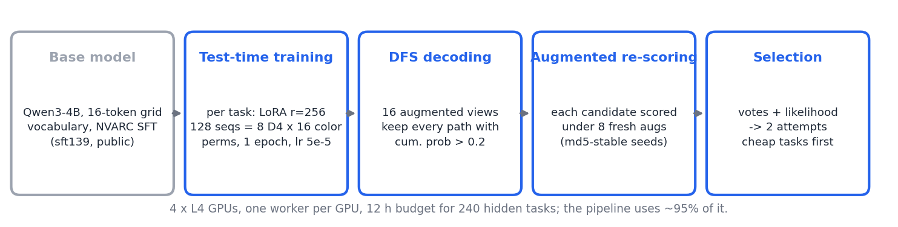
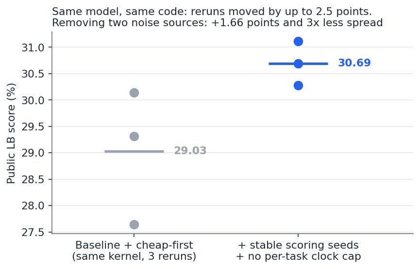
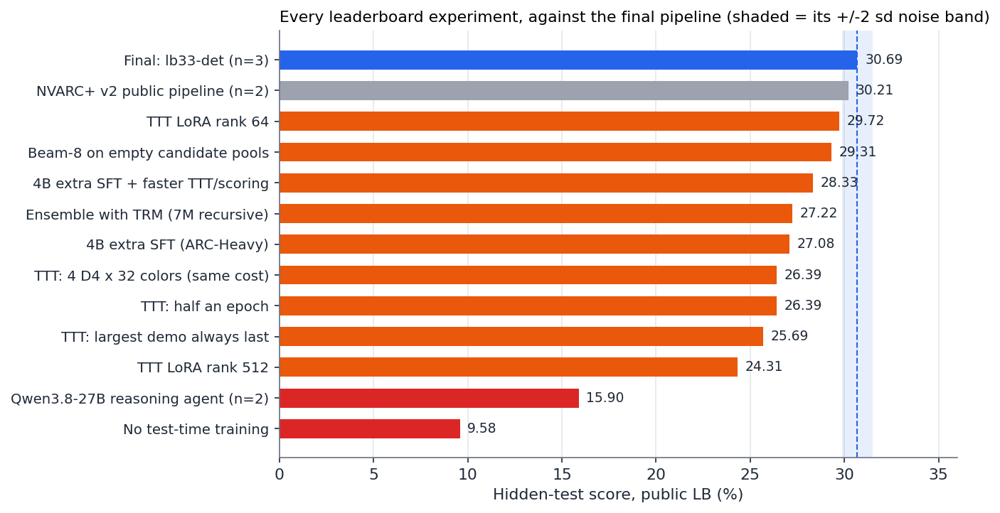
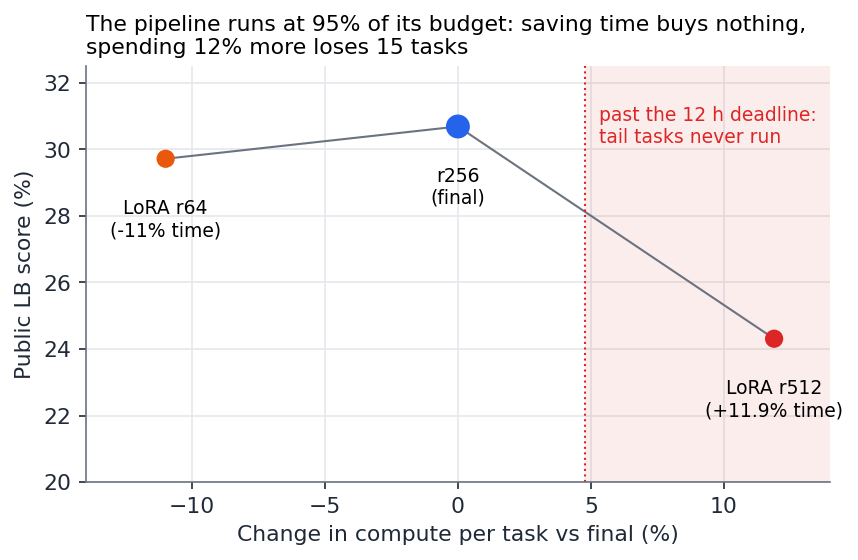
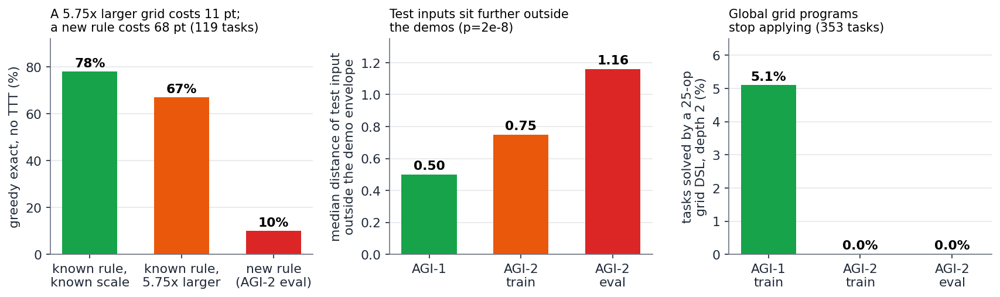
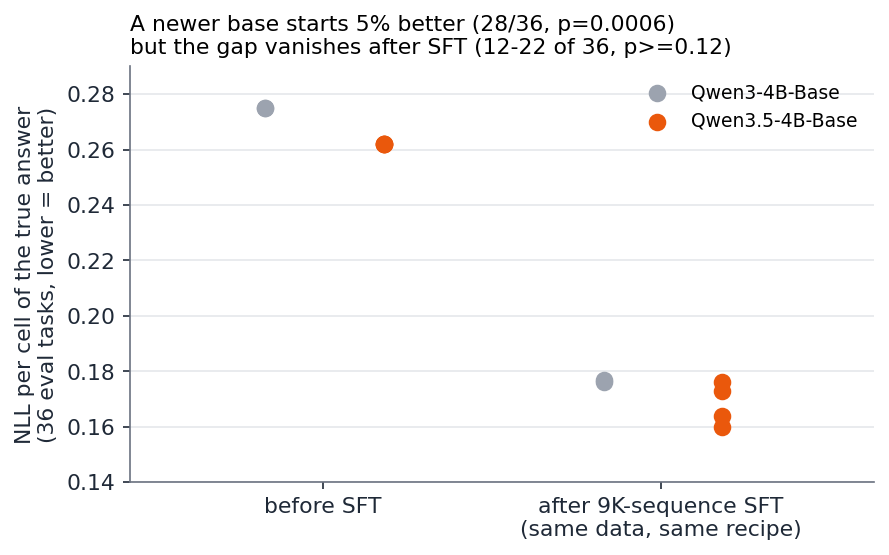

# Measuring Before Moving: Why Test-Time Training Plateaus on ARC-AGI-2

**Julian Camilo Villaduque** · ARC Prize 2026, ARC-AGI-2 track · Final submission: `lb33-det`,
**30.69 ± 0.42 %** on the public leaderboard (3 reruns; best single run 31.11 %)

Code (MIT): https://github.com/jvilladuque90/arc-prize-2026-arc-agi-2

---

## In plain words

ARC-AGI-2 shows a few input/output examples of an unknown rule and asks for the output of a new input.
The strongest public approach lets a language model *briefly study each puzzle* before answering. I
took that approach and asked a simple question: **which changes really improve the hidden score, and
which only look like they do?**

My contribution is not a new model. It is a **measurement method** and a **diagnosis**:

1. **The leaderboard was noisier than the improvements people chase.** The same notebook, rerun three
   times, scored between 27.6 and 30.1. I found the two bugs that caused it and removed them:
   **+1.66 points and 3× less variation**, at zero extra cost.
2. **Studying each puzzle is the engine** (worth 21 of the 31 points), and its recipe is already tuned.
   All five changes I sent to the leaderboard lost.
3. **The model fails for one reason: the test input asks for the rule in a situation the examples never
   showed.** More data, bigger models and program search do not fix that, and I show why with cheap
   measurements.

Every leaderboard experiment is reported, including the negative ones (Figure 3), so the next team
does not have to pay for them again.

---

## 1. The pipeline

| Stage | What it does | My change |
|---|---|---|
| Base model | Qwen3-4B (a 4-billion-parameter language model) trained by NVARC, 2025 winners, on 266K synthetic puzzles; its vocabulary is cut to the 10 colors plus a few markers | none |
| Test-time training (TTT) | For each puzzle, train a small adapter (LoRA) on its examples, shown in 128 versions: rotated, mirrored and with colors swapped | none |
| Search | Under 16 versions of the puzzle, list every answer the model finds at least 20 % likely | **no per-puzzle time limit** |
| Re-scoring | Score each candidate under 8 more versions | **fixed random seeds** |
| Selection | Keep the 2 answers with the most votes and likelihood | **cheapest puzzles first** |

**Why it works.** A single model cannot know every rule. Training on the examples of one puzzle turns
"guess a new rule" into "repeat a rule just learned". Rotations and color swaps teach the model what in
the rule is essential and what is incidental.

---

## 2. First, fix the instrument

Rerunning the *unchanged* notebook moved the score by 2.5 points. Most improvements I had tested were
smaller than that, so their results meant nothing. The logs showed two causes:

- **Random seeds that changed every run.** Python's `hash()` gives different values in each process, so
  each run judged the candidates from different angles. A fixed hash (md5) solved it.
- **A per-puzzle time limit that puzzles barely met.** One puzzle started its last step 40 seconds before
  its 20-minute limit; a 3.5 % change in machine speed decided whether it got its full search. The
  overall 12-hour limit already protects the submission, so I removed the per-puzzle one.

With both fixes three reruns scored **31.11, 30.69 and 30.28**: the worst beats the best of the old
version. From then on I **wrote down the adopt/discard score before each
submission** and compared runs puzzle by puzzle, not just by the mean.

---

## 3. What I tried on the leaderboard

Each bar is one submission to the hidden test; the shaded band is the normal variation of the final pipeline.

**Studying each puzzle is the engine.** Without it, the same model scores 9.58: it is worth **+21 points
for 35 % of the run time**. Its recipe is finely balanced:

| Change to the per-puzzle training | Score | Why it lost |
|---|---|---|
| half as many training steps | 26.39 | half of the puzzle versions are never learned |
| largest example always shown last | 25.69 | varied example order prevents shortcuts: −12 puzzles |
| fewer rotations, more color swaps (same cost) | 26.39 | geometry teaches more than color |
| smaller / larger adapter | 29.72 / 24.31 | see the clock, below |

A small 18-puzzle test had called the color-swap variant neutral; the hidden test said −4.3 points.
**A small test that shows "no harm" is not a green light.**

**Time is a cliff, not a slope.** The pipeline already uses 95 % of the 12 hours. A larger adapter cost
12 % more time and lost 15 puzzles, because the last puzzles in the queue never ran. A smaller one
saved 11 % and gained nothing. Rule of thumb: **any change must cost under ~5 % extra time.** That
excludes "thinking" models, more search and longer training.

**Other directions, all measured on the hidden test:**

- **Combining with a weaker model** (2B, or the tiny 7M-parameter TRM) lost up to 3 points: every
  minute given to a weaker partner is taken from the stronger one.
- **More training data for the 4B model** gave 27.08 / 28.33: it produced more candidate answers, which
  took longer to check, so fewer puzzles finished. The same data *helped* a smaller, faster 2B model (+2.2).
- **Searching harder when no answer was found**: 29.31. If the model has no candidate, it does not know the rule.

---

## 4. Why it is hard to climb

- **A new rule is far harder than a bigger grid** (left). The model solves 78 % of familiar rules,
  still 67 % when the grid is 5.75× larger, but only 10 % of the new rules in ARC-AGI-2. Synthetic
  data can only teach rules we can already write down, so it cannot close this gap.
- **The test input lies outside what the examples show** (middle). I measured how far each test input
  falls outside the range of its examples (size, amount of color, objects…). The distance more than
  doubles from ARC-AGI-1 to ARC-AGI-2. Test grids hold more content than any example.
- **The model learns the rule but fails the test.** After per-puzzle training it solves a held-out
  *example* in 5 of 12 puzzles but the real *test* in 0 of 12. It learned the rule as shown, not the
  concept behind it.
- **Program search does not reach ARC-AGI-2** (right). A library of 25 grid operations solves 5 % of
  ARC-AGI-1 and 0 of 353 ARC-AGI-2 puzzles; an object-based version does no better. The new rules depend
  on *relations between objects*. Checking a candidate program against the examples, however, is right
  87 % of the time, a useful filter for future hybrid systems.

**Why the approach stops at ~31 %.** Per-puzzle training learns the rule *in the form the examples show
it*. ARC-AGI-2 deliberately builds test inputs where that form no longer works. The missing ingredient is
not data, search or compute but **generalization from the examples to a new situation**: exactly what
the benchmark was designed to measure.

---

## 5. A newer base model

I compared Qwen3.5-4B, a newer model with a different architecture, against Qwen3-4B fairly: both raw
versions, same data, same training. A first, careless comparison had exaggerated the difference by 44 %.

- Before training, Qwen3.5 is 5 % better at predicting correct answers (28 of 36 puzzles).
- After the **same** training, the advantage disappears: four runs win 19, 12, 17 and 22 of 36 puzzles.
  It is also 8 % slower.

**A better starting point, but no faster learning.** I trained a full Qwen3.5 model and adapted the
whole pipeline to it, but the weekly GPU quota ran out before submission. The code is in the repository.

---

## 6. Advice for the next team

1. **Measure your leaderboard's noise first.** My biggest gain came from removing randomness, not from a new idea.
2. **Write the adopt/discard threshold before the score arrives.** It stops you reading noise as progress.
3. **Budget time before designing.** At 95 % use of the time limit, a good idea that costs 12 % is worse than no idea.
4. **Test on the same model and data as production.** A small test model had memorized the public puzzles
   and told me the core technique was useless.
5. **Ask the data first.** Analyses on a laptop closed directions that would each have cost a week of GPU.
6. **Where to look next:** methods that turn the examples into a *concept* that transfers to the test
   input, for instance combining per-puzzle training with exact checking of candidate programs.

These rules apply to any benchmark judged on one hidden run, not only to ARC.

**Reproducibility.** Notebooks are generated by `scripts/build_*.py`; the final submission is
`notebooks/lb33_det.ipynb`; each prediction and outcome is logged in `PLAN.md` and `docs/PREREG_*.md`.

**Acknowledgements.** NVARC (Sorokin and Puget), the public LB33 notebook, and the ARChitects' recipe.
